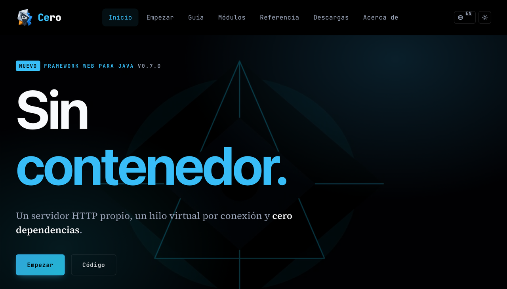

# Cero

**Un framework de backend escrito como contrato: el mismo comportamiento en Java, Rust, C++ y
Python, juzgado por un banco de pruebas que no sabe en qué lenguaje está escrito quien responde.**

Cero dependencias en ejecución, en ninguna implementación. Tú eliges el lenguaje; el contrato
garantiza que todos se portan igual.

[](https://central.sonatype.com/namespace/dev.ginit.cero)
[](spec/)
[](LICENSE)
[](https://cero.ginit.dev)

> [!NOTE]
> **English** — Cero is a backend framework defined as a language-neutral contract: 182 numbered
> requirements in [`spec/`](spec/), implemented in Java, Rust, C++ and Python, and checked by a
> black-box test bench that only sees bytes on a socket. Zero runtime dependencies everywhere.
> One install line per language is in the table below. Documentation in English lives at
> **[cero.ginit.dev/en](https://cero.ginit.dev/en)**; this repository is written in Spanish on
> purpose.



## Empezar en cinco minutos

Una línea para instalar y una orden para arrancar. Cada carpeta de [`ejemplos/`](ejemplos/) trae la
misma API de tres rutas, su prueba de punta a punta y el comando con el que se midió su memoria.

| Lenguaje | Instalar | Arrancar | Memoria en reposo |
|---|---|---|---|
| [Rust](ejemplos/rust/) | `cargo add cero-http --git https://github.com/Andre031222/Cero` | `cargo run --release` | 1,7 MiB |
| [C++](ejemplos/c++/) | `FetchContent_Declare(cero GIT_REPOSITORY https://github.com/Andre031222/Cero GIT_TAG main SOURCE_SUBDIR c++)` | `cmake -S . -B build && cmake --build build && ./build/hola` | 1,6 MiB |
| [Python](ejemplos/python/) | `pip install "git+https://github.com/Andre031222/Cero#subdirectory=python"` | `python3 app.py` | 23,5 MiB |
| [Java](ejemplos/java/) | `dev.ginit.cero:cero-core:0.8.0` desde Maven Central | `mvn -q package && java -jar target/ejemplo.jar` | 57 MiB |

Las tres rutas son las mismas en los cuatro:

```text
GET  /                 → {"hola":"mundo"}
GET  /saludo/{nombre}  → {"saludo":"hola, <nombre>"}
POST /eco              → el JSON que recibió, o 400 si no es JSON
```

Así se ven en Rust:

```rust
use cero_http::{Json, Respuesta, Servidor};
use std::{env, io};

fn main() -> io::Result<()> {
    let puerto = env::var("PUERTO").ok().and_then(|p| p.parse().ok()).unwrap_or(8080);
    Servidor::vacio()
        .get("/", |_| Respuesta::json(Json::objeto(vec![("hola", "mundo".into())])))
        .get("/saludo/{nombre}", |c| {
            let nombre = c.variable("nombre").unwrap_or("mundo");
            Respuesta::json(Json::objeto(vec![("saludo", format!("hola, {nombre}").into())]))
        })
        .post("/eco", |c| Ok(Respuesta::json(c.cuerpo_json()?)))
        .direccion("127.0.0.1")
        .escuchar(puerto)
}
```

Es [`ejemplos/rust/src/main.rs`](ejemplos/rust/src/main.rs) completo. Los otros tres lenguajes
están en sus carpetas de `ejemplos/`.

O, con la orden `cero`, un proyecto nuevo ya montado:

```bash
cero new mi-api --lenguaje rust      # o c++, python, java
```

La memoria es una medición del ejemplo recién arrancado y sin peticiones, en un Mac con arm64. El
comando para repetirla está en el LEEME de cada ejemplo. Los ejemplos escuchan solo en `127.0.0.1`;
su LEEME dice cómo abrirlos a la red.

## Qué lenguaje elegir

Todos cumplen el mismo contrato, así que la elección depende de dónde va a correr:

| Si tienes… | Elige | Por qué |
|---|---|---|
| Un VPS pequeño o un equipo con poca RAM | **Rust** o **C++** | Menos de 2 MiB en reposo y un solo binario |
| Una aplicación de escritorio en Rust (por ejemplo, con Tauri) | **Rust** | El mismo crate, sin servidor aparte |
| Un equipo que ya programa en Python | **Python** | Sin dependencias; también se empaqueta en un solo `.pyz` |
| Un ecosistema Java y Maven | **Java** | Publicado en Maven Central, con el conjunto de módulos más completo |

## Qué es

Cero empezó por una molestia concreta: para desplegar una aplicación Java había que montar Tomcat,
empaquetar un WAR y confiar en la configuración del servidor. Por eso Cero trae su propio servidor
HTTP/1.1 y HTTP/2, con TLS: `java -jar app.jar` y está corriendo.

De ahí salió la idea que lo define: **lo que importa no es una implementación, sino el
comportamiento**. Ese comportamiento está escrito en [`spec/`](spec/) como 182 requisitos numerados
—rutas, pipeline, petición y respuesta, sesiones, seguridad, HTTP/2— y cada lenguaje lo implementa
desde cero, sin copiar el código de otro.

El juez es [`spec/banco/`](spec/banco/): manda bytes por un socket y mira lo que vuelve. No sabe si
del otro lado hay Java o C++.

Tres principios:

- **Cero dependencias en ejecución.** Solo la biblioteca estándar de cada lenguaje. Las
  herramientas de construcción (cargo, CMake, pip, Maven) no cuentan.
- **Medido, no proclamado.** Toda cifra de este README sale de un comando que se puede repetir.
- **Solo backend.** Cero responde JSON y bytes, y sirve a cualquier frontend.

## Estado

| Implementación | Estado | Banco | Ataques | h2spec | Requisitos |
|---|---|---|---|---|---|
| [Java](java/) | completa | 23 de 23 | 11 de 11 | 145 de 146 | 182 de 182 |
| [Rust](rust/) | completa | 23 de 23 | 11 de 11 | 145 de 146 | 182 de 182 |
| [C++](c++/) | completa | 23 de 23 | 11 de 11 | 145 de 146 | 175 de 175 aplicables |
| [Python](python/) | en marcha | 23 de 23 | 3 de 3, sin HTTP/2 | todavía no | 83 citados en pruebas |
| PHP | planeada | | | | |

- **Banco:** 23 vectores de conformidad con HTTP/1.1 (RFC 9112).
- **Ataques:** 11 vectores de abuso, inspirados en la familia HTTP/2 Bomb, más pruebas de que el
  tráfico legítimo grande no se castiga. Están en [`spec/banco/ataques.py`](spec/banco/ataques.py).
- **h2spec:** el único fallo es el mismo en las tres, porque la prueba asume un puerto dedicado a h2c.
- **C++** no cita siete requisitos que se retiran por no poderse observar desde fuera (`RUT-032` a
  `RUT-034`, `RUT-036`, `RUT-037`, `SES-011` y `SES-013`), de ahí 175.
- **Python** tiene HTTP/1.1, ruteo, sesiones, seguridad y observabilidad. Le faltan HTTP/2,
  `RUT-014` a `RUT-037` y `SES-010`.

Diez requisitos (`H2-040` a `H2-049`) nacieron en la implementación de Rust, de fallos que h2spec le
encontró. Java ya los cumplía, pero nadie los había escrito. Es la prueba de que el contrato no es
una transcripción de Java.

> [!IMPORTANT]
> **Nadie lo ha usado en producción con tráfico real durante meses.** El parser HTTP es la
> superficie que da a internet: hasta que acumule kilómetros, no es honesto llamarlo maduro. Lo que
> falta está en [docs/produccion.md](docs/produccion.md).

## Comprobar todo con una orden

```bash
./cero verificar               # en Windows: cero verificar
./cero verificar --sin-motores # sin PostgreSQL ni MySQL escuchando
```

Corre lo esencial de la integración continua sin parar en el primer fallo:

- el orden del repositorio y la ausencia de comentarios en el código;
- las pruebas de los cuatro lenguajes;
- el banco y los ataques contra cada uno;
- h2spec contra los tres que hablan HTTP/2;
- la cuenta de requisitos;
- y cada ejemplo, que arranca y debe responder `{"hola":"mundo"}`.

Termina con una línea por comprobación y un ✓ o un ✗. Si falta una herramienta, su línea sale con ✗
y la razón: nada se omite en silencio. Los detalles están en [docs/guiones.md](docs/guiones.md).

## Java

Java 25 o superior y Maven. Está en Maven Central:

```xml
<dependency>
    <groupId>dev.ginit.cero</groupId>
    <artifactId>cero-core</artifactId>
    <version>0.8.0</version>
</dependency>
```

```java
@Route("/api")
class ApiController {

    @Inject Catalogo catalogo;

    @Get("/articulos/{id}")
    public Object porId(@Path("id") int id) {
        return catalogo.porId(id);
    }
}

Cero.run(8080, ApiController.class);
```

De dónde sale cada argumento se decide al registrar la ruta, no en cada petición, así que el camino
caliente no usa reflexión.

| Módulo | Qué trae |
|---|---|
| [`cero-http`](java/cero-http) | Servidor HTTP/1.1 y HTTP/2 (h2c y h2 por ALPN) con un hilo virtual por conexión, TLS recargable, sesiones, multipart, gzip, estáticos con `Range`, WebSocket y eventos del servidor |
| [`cero-core`](java/cero-core) | Router, middleware, inyección, JSON propio, validación, CORS, CSRF, límites de peticiones, métricas, OAuth 2.0 con PKCE, tareas con cron, correo SMTP, trazado W3C y OpenAPI |
| [`cero-data`](java/cero-data) | `Db`, `Pool`, `Tx`, `Repository`, sesiones en tabla y migraciones, probado contra H2, PostgreSQL 16 y MySQL 8 reales |
| [`cero-test`](java/cero-test) | Pruebas de punta a punta para quien usa Cero |
| [`cero-adapter-servlet`](java/cero-adapter-servlet) | La puerta de salida: la misma aplicación en Tomcat sin tocar el código |
| [`cero-launcher`](java/cero-launcher) | La orden `cero`: `new`, empaquetado en un jar y migraciones |

El núcleo (`cero-http`, `cero-core` y `cero-data`) pesa unos 370 KiB y no declara ninguna
dependencia externa. El driver JDBC lo pone la aplicación.

El instalador deja la orden `cero` en el PATH:

```bash
curl -fsSL https://cero.ginit.dev/instalar | sh     # macOS y Linux
irm https://cero.ginit.dev/instalar.ps1 | iex       # Windows (PowerShell)
```

Comprueba el `sha256` del paquete, no pide contraseña y no escribe fuera de tu carpeta personal. Los
dos guiones se sirven como texto plano para que puedas leerlos antes:
[instalar](https://cero.ginit.dev/instalar) · [instalar.ps1](https://cero.ginit.dev/instalar.ps1).

### Rendimiento en la JVM

Ocho frameworks en contenedores idénticos, 120 mediciones sin errores, sobre Cero 0.8.0:

| Framework | Arranque | RSS | rps `/json` |
|---|---|---|---|
| **Cero** | **155 ms** | 307,9 MB | 94 634 |
| Jooby | 443 ms | **73,4 MB** | 93 281 |
| Vert.x | 481 ms | 79,5 MB | **98 589** |
| Javalin | 518 ms | 117,4 MB | 88 773 |
| Helidon | 583 ms | 83,3 MB | 92 693 |
| Quarkus | 711 ms | 104,6 MB | 91 823 |
| Micronaut | 1 102 ms | 104,7 MB | 76 465 |
| Spring Boot | 2 446 ms | 176,5 MB | 64 133 |

- **Arranque:** Cero es el más rápido, 2,9 veces por debajo del segundo.
- **Peticiones por segundo:** Vert.x lo supera de forma medible; con Jooby y Helidon hay empate.
- **Memoria bajo carga:** Cero es el peor. No es una fuga: llena el montón que se le da, y con
  `-Xmx96m` sirve lo mismo en 176 MB. Es lo siguiente que hay que arreglar.

Valen las comparaciones dentro de la misma corrida, no los absolutos: el generador de carga comparte
máquina con el servidor. La tabla completa, sus parámetros y cómo rehacerla están en
[`benchmarks/results/`](benchmarks/results/RESULTS-docker.md).

## Estructura

```text
spec/         El contrato y su banco, neutrales respecto al lenguaje
java/         Implementación en Java: siete módulos
rust/         Implementación en Rust
c++/          Implementación en C++
python/       Implementación en Python, en marcha
ejemplos/     La misma API de tres rutas en cada lenguaje
herramientas/ Comprobaciones del repositorio
benchmarks/   Comparativa entre frameworks y prueba de carga sostenida
docs/         Documentación
cero          La orden del proyecto: new, verificar, test, fatjar…
```

## Documentación

| Documento | Qué responde |
|---|---|
| [produccion.md](docs/produccion.md) | ¿Está listo para producción? Todavía no, y ahí está la lista |
| [arquitectura.md](docs/arquitectura.md) | El diseño |
| [versiones.md](docs/versiones.md) | Qué cambió en cada versión |
| [guiones.md](docs/guiones.md) | La orden `cero` y la integración continua |
| [SECURITY.md](SECURITY.md) | Cómo informar de una vulnerabilidad |
| [autores.md](docs/autores.md) | Autoría y procedencia |

**Versión publicada:** 0.8.0 en Maven Central. **En desarrollo:** 0.9.0, con Rust, C++ y Python
instalables desde este repositorio.

## Licencia y autoría

Apache 2.0. Ver [LICENSE](LICENSE) y [NOTICE](NOTICE).

Autor: **Richar Andre Vilca-Solorzano**. Universidad Nacional del Altiplano, Facultad de Ingeniería
Estadística e Informática, Puno, Perú. La procedencia del código está en
[docs/autores.md](docs/autores.md).

```bibtex
@software{vilcasolorzano2026cero,
  title  = {Cero: un framework de backend poliglota definido por contrato},
  author = {Vilca-Solorzano, Richar Andre},
  year   = {2026},
  url    = {https://github.com/Andre031222/Cero}
}
```

---

Cero · por Andre Solorzano
