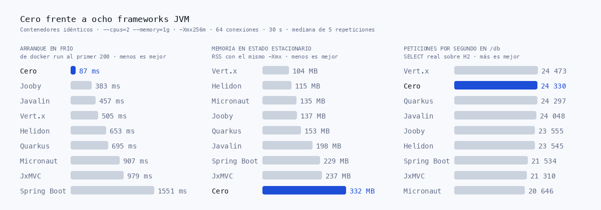
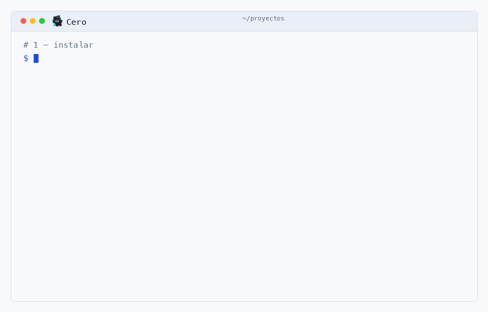

# Cero

**Cero no es un framework; es el contrato de un framework de backend, con implementaciones en varios
lenguajes que lo cumplen y un juez que no conoce el lenguaje.**

El contrato son los 182 requisitos numerados de [`spec/`](spec/). El juez es el banco de
[`spec/banco/`](spec/banco/): bytes sobre un socket, que no saben en qué lenguaje está escrito
quien responde. Sin dependencias de terceros en ejecución, en ninguna implementación.

| Implementación | Estado | Banco | Ataques | h2spec | Requisitos |
|---|---|---|---|---|---|
| [Java](java/) | completa | 23 de 23 | 11 de 11 | 145 de 146 | 182 de 182 |
| [Rust](rust/) | completa | 23 de 23 | 11 de 11 | 145 de 146 | 182 de 182 |
| [C++](c++/) | en marcha, hito 11 | 23 de 23 | 11 de 11 | 145 de 146 | 157 citados en pruebas, de 182 |
| [Python](python/) | en marcha, hito 4 | 23 de 23 | 3 de 3, sin h2 | no aplica, sin h2 | 83 citados en pruebas, de 182 |
| PHP | planeada | por empezar | por empezar | por empezar | por empezar |

El único fallo de h2spec es el mismo en las tres que hablan HTTP/2: asume un puerto dedicado a
h2c. Python todavía no habla h2, así que de los once ataques corre los tres de HTTP/1.1. Los ataques,
inspirados en la familia de ataques HTTP/2 Bomb, y los plazos están en
[`spec/banco/ataques.py`](spec/banco/ataques.py).

[](https://central.sonatype.com/namespace/dev.ginit.cero)
[](https://openjdk.org/)
[](#principios)
[](#estado)
[](LICENSE)
[](https://cero.ginit.dev)

> [!NOTE]
> **English** — Cero is not a framework; it is the contract of a backend framework, with
> implementations in several languages that satisfy it and a judge that does not know the
> language. The Java implementation has its own HTTP server, one virtual thread per connection and
> zero runtime dependencies. Documentation is available in English at
> **[cero.ginit.dev/en](https://cero.ginit.dev/en)**; this repository and its commit history are
> written in Spanish, which is deliberate.

**En producción:** [cero.ginit.dev](https://cero.ginit.dev) — el sitio de este proyecto,
servido por el propio framework, sin Tomcat detrás. Su código está abierto en
[`cero-sitio`](https://github.com/Andre031222/cero-sitio): React con Vite delante, Cero detrás,
los dos dentro del mismo jar. Es la aplicación de ejemplo más completa que hay, y se puede
comprobar que la afirmación de arriba es cierta en vez de creerla.


* * *

## Qué es

Cero sale de una molestia concreta: desplegar una aplicación Java suponía montar un contenedor de
servlets, empaquetar un WAR, copiarlo a Tomcat y confiar en que la configuración del servidor
fuera la que uno creía. Nada de eso es el programa que uno escribió.

De ahí las tres decisiones que definen el proyecto:

1. **Arranca solo.** Servidor HTTP/1.1 y HTTP/2 propio, con un hilo virtual por conexión. `java -jar app.jar`
   y está corriendo: sin contenedor de servlets, sin `web.xml`, sin despliegue.
2. **No es solo Java.** Lo que define a Cero es un *contrato* —rutas, pipeline,
   request/response, inyección, configuración— escrito de forma neutral e implementado en
   **Java, Rust y C++**, con Python en marcha, PHP por venir y un mismo banco de conformidad para todos. Por
   eso existe [`spec/`](spec/) en vez de tomar el código Java como referencia.
3. **Solo backend.** Cero responde JSON y bytes; no pinta HTML.

## Principios

- **Cero dependencias en ejecución.** Solo el JDK. El driver JDBC lo pone la aplicación, y es la
  única excepción.
- **Legible antes que ingenioso.** Si una clase no se puede leer de corrido, se parte.
- **Medido, no proclamado.** Toda afirmación de rendimiento sale de [`benchmarks/`](benchmarks/),
  con el mismo harness para todos los contendientes.
- **El contrato manda.** Ninguna implementación es la de referencia: la referencia
  es `spec/`, y todas pasan las mismas pruebas.

## Rendimiento

*Ocho frameworks, contenedores idénticos, 120 mediciones sin un solo error ni una sola respuesta
no-2xx, sobre Cero 0.8.0. La tabla completa y sus parámetros están en
[`RESULTS-docker.md`](benchmarks/results/RESULTS-docker.md), con su CSV al lado
([`raw-docker.csv`](benchmarks/results/raw-docker.csv)). [Cómo se rehace](benchmarks/results/LEEME.md).*

> [!WARNING]
> **Qué entorno describe `ENV.md` y qué no.** El único
> [`ENV.md`](benchmarks/results/ENV.md) del repositorio describe un portátil con macOS y Docker
> Desktop: el motor corre dentro de una máquina virtual, el cliente de carga comparte máquina con el
> servidor y había otros servicios en marcha. Dice de sí mismo que no cumple el protocolo y que los
> números absolutos no son publicables. La tabla de abajo es la de `RESULTS-docker.md`, cuya
> cabecera anota otro anfitrión (Linux x86_64, cliente fijado a núcleos aparte), pero esa corrida
> no tiene un `ENV.md` propio. Por eso **este README no afirma nada sobre la virtualización de esa corrida**:
> valen las comparaciones dentro de la misma corrida, no los absolutos.

<picture>
  <source media="(prefers-color-scheme: dark)" srcset="docs/imagenes/banco.png">
  
</picture>

| Framework | Arranque | Imagen | RSS | rps `/plaintext` | rps `/json` | rps `/db` |
|---|---|---|---|---|---|---|
| **Cero** | **155 ms** | 323,2 MB | 307,9 MB | 93 577 | 94 634 | 86 690 |
| Jooby | 443 ms | 310,8 MB | **73,4 MB** | 94 112 | 93 281 | 84 429 |
| Vert.x | 481 ms | 316,3 MB | 79,5 MB | **99 241** | **98 589** | **88 368** |
| Javalin | 518 ms | 311,4 MB | 117,4 MB | 89 193 | 88 773 | 68 686 |
| Helidon | 583 ms | **308,4 MB** | 83,3 MB | 90 078 | 92 693 | 79 402 |
| Quarkus | 711 ms | 321,0 MB | 104,6 MB | 93 409 | 91 823 | 65 069 |
| Micronaut | 1 102 ms | 317,6 MB | 104,7 MB | 76 941 | 76 465 | 64 751 |
| Spring Boot | 2 446 ms | 325,0 MB | 176,5 MB | 60 903 | 64 133 | 49 870 |

**En arranque no hay discusión.** 155 ms, **2,9× por debajo del segundo** y 15,8× por debajo de
Spring Boot.

**En peticiones por segundo, Cero está arriba pero no gana.** Vert.x lo supera de forma medible:
98 589 contra 94 634 en `/json`, y los intervalos de las cinco repeticiones no se solapan
—Cero entre 93 095 y 95 777, Vert.x entre 97 913 y 99 828—. Con Jooby y Helidon sí hay empate:
las diferencias caben dentro de la variación de cada uno.

**En memoria Cero es el peor**, y por mucho: 307,9 MB frente a los 73,4 de Jooby. No es una fuga
—el RSS se estanca, y con `-Xmx96m` sirve el mismo tráfico algo más rápido en 176 MB—, es que
asigna más por petición y llena el montón que se le da. Es lo siguiente que hay que arreglar.

> [!NOTE]
> El generador de carga comparte máquina con el servidor, así que los rps son una **cota
> inferior** limitada por el camino de red del contenedor, idéntico para todos.

## Instalar

Java 25 o superior (hilos virtuales) y Maven. Nada más.

Está en Maven Central. Tres líneas y ya está:

```xml
<dependency>
    <groupId>dev.ginit.cero</groupId>
    <artifactId>cero-core</artifactId>   <!-- arrastra cero-http -->
    <version>0.8.0</version>
</dependency>
```

`cero-data`, `cero-test`, `cero-adapter-servlet` y `cero-launcher` van aparte, y se toman solo si
se usan. Ninguno arrastra nada de fuera.

### El instalador

Sirve para tener la orden `cero`, que es la que crea proyectos ya montados.

<picture>
  <source media="(prefers-color-scheme: dark)" srcset="docs/imagenes/instalar.gif">
  
</picture>

```bash
curl -fsSL https://cero.ginit.dev/instalar | sh          # macOS y Linux
irm https://cero.ginit.dev/instalar.ps1 | iex            # Windows (PowerShell)
```

Baja el paquete, comprueba su `sha256`, lo compila, deja los artefactos en tu `~/.m2` y te pone la
orden `cero` en el PATH. No pide contraseña y no escribe fuera de tu carpeta personal. Los dos
guiones se sirven como texto plano a propósito —[instalar](https://cero.ginit.dev/instalar) ·
[instalar.ps1](https://cero.ginit.dev/instalar.ps1)— para que puedas leerlos antes de ejecutarlos.

Después:

```bash
cero new mi-app
cd mi-app && mvn -q package && java -jar target/mi-app.jar
```

Y desde el código fuente, que es lo mismo paso a paso:

```bash
git clone https://github.com/Andre031222/Cero.git && cd Cero
cd java && mvn install     # 1 600 pruebas, runner propio (sin JUnit)
./cero fatjar ejemplo       # un solo jar: java -jar ejemplo.jar
```

<details>
<summary>Las pruebas contra PostgreSQL y MySQL reales, si las quieres correr</summary>

<br>

`cero-data` corre su batería contra motores de verdad. Sin ellos escuchando se omiten esos grupos
y el resto sigue:

```bash
docker run -d --name cero-pg -e POSTGRES_PASSWORD=cero -e POSTGRES_DB=ceropruebas \
       -p 55432:5432 postgres:16-alpine
docker run -d --name cero-my -e MYSQL_ROOT_PASSWORD=cero -e MYSQL_DATABASE=ceropruebas \
       -p 53306:3306 mysql:8
```

</details>

En [integración continua](.github/workflows/pruebas.yml) se levantan siempre, y la corrida **falla
si algún motor quedó sin probar** — para que la suite no pueda mentir por omisión.

### Saber si todo está bien, en una orden

```bash
./cero verificar          # cero verificar en Windows
```

Corre lo esencial de integración continua, sin parar en el primer fallo: el orden y los comentarios,
las pruebas de Java, Rust, C++ (esta en un directorio de compilación nuevo) y Python, el banco y los
ataques contra las cuatro, h2spec contra las tres que hablan HTTP/2 y la cuenta de requisitos. La
línea de h2spec de Python sale con «n/a», que no cuenta como fallo, y sus ataques corren con
`--solo-http1`. Termina con una línea por
comprobación, con su cifra y un ✓ o un ✗, y sale con 1 si alguna falla. Hacen falta Maven y JDK 25,
cargo, cmake, h2spec y Python 3.12 o superior (busca `python3.14`, `python3.13`, `python3.12` y
`python3`, y dice cuál usó). Una herramienta que falta marca su línea con ✗ y la razón: nada se
omite en silencio.

Lo que CI hace y `verificar` no: comprobar que el núcleo no arrastra dependencias en runtime,
empaquetar los JAR, el inventario de dependencias, la revisión de dependencias con CVE conocido y la
matriz de versiones. Y al revés, `verificar` pasa h2spec también contra C++, que CI no.

Sin PostgreSQL ni MySQL escuchando, la línea de Java sale ✗ ("motores reales sin probar"), porque en
integración continua eso es un fallo. Con `./cero verificar --sin-motores` esa línea sale con un `–`
("omitido a pedido"), el código de salida es 0 y la última línea avisa de que la corrida no equivale
a CI.

Para sumar una implementación nueva basta una línea en `IMPLEMENTACIONES`, al principio de la
función en `cero` (y en `$Implementaciones` en `cero.ps1`): nombre, carpeta, herramientas, orden de
pruebas, preparación del servidor, cómo arrancarlo, dónde están los requisitos y su mínimo. La
carpeta entra sola en la comprobación de comentarios. El puerto es el 8777 y se cambia con
`CERO_PUERTO`.

## Un vistazo

```java
@Route("/api")
class ApiController {

    @Inject Catalogo catalogo;

    @Get("/articulos/{id}")
    public Object porId(@Path("id") int id) {
        return catalogo.porId(id);
    }
}

Cero.run(8080, ApiController.class);
```

Eso levanta ruteo, inyección de dependencias, serialización JSON y manejo de errores. De dónde sale
cada argumento se decide **al registrar la ruta**, no en cada petición: el camino caliente no toca
la reflexión.

## Los módulos

| Módulo | Pruebas | Qué trae |
|---|---|---|
| [`cero-http`](java/cero-http) | 434 | Servidor HTTP/1.1 y HTTP/2 con un hilo virtual por conexión: keep-alive, chunked, `Expect: 100-continue`, TLS recargable sin reiniciar, cookies, sesiones con rotación de identificador y almacén enchufable, multipart, gzip, estáticos con `Range`, `Cache-Control` y respaldo para aplicaciones de una sola página, **WebSocket** (RFC 6455), **eventos del servidor** (SSE), **HTTP/2** —h2c y h2 sobre TLS por ALPN— y confianza en proxy configurable |
| [`cero-core`](java/cero-core) | 781 | Router, pipeline con middleware, inyección con detección de ciclos, JSON propio, vinculación de parámetros, clase base de controlador **opcional**, CORS, CSRF, rate limiting, validación, cabeceras de seguridad, métricas, logs, OAuth 2.0 con PKCE, PBKDF2, caché, eventos, tareas en segundo plano con cron, **correo SMTP**, **trazado W3C** y OpenAPI |
| [`cero-data`](java/cero-data) | 250 | `Row`, `Db`, `Pool`, `Tx`, `Repository<T, ID>`, `JdbcSessions` —sesiones en tabla— y `Migrations` —esquema versionado—. Todo por `PreparedStatement`. La misma batería corre contra **H2, PostgreSQL 16 y MySQL 8 reales** |
| [`cero-test`](java/cero-test) | 29 | Pruebas de punta a punta para quien usa Cero: levanta la aplicación en un puerto libre, cliente HTTP que mantiene las cookies y deja fijar la versión del protocolo, y aserciones legibles sobre la respuesta |
| [`cero-adapter-servlet`](java/cero-adapter-servlet) | 35 | La puerta de salida: la misma aplicación se despliega en Tomcat sin tocar el código, para que migrar sea reversible |
| [`cero-launcher`](java/cero-launcher) | 12 | La línea de órdenes: el generador de `cero new`, el empaquetado en un jar ejecutable con `java.util.jar` y sin plugins de terceros, y las migraciones |
| [`ejemplo`](java/ejemplo) | 59 | Aplicación pequeña de punta a punta: API REST paginada con validación, base de datos, sesiones y CSRF |

El núcleo son tres módulos —`cero-http`, `cero-core` y `cero-data`—, no declaran ninguna dependencia
externa y pesan **378 796 bytes** (≈ 370 KiB, `ls -l` de los tres jars de `0.8.0` tras `mvn install`: 137 857 +
187 306 + 53 633). La única referencia a `jakarta.*` en todo el proyecto está en
`cero-adapter-servlet`, en *scope* `provided`.

## Estado

**Versión 0.8.0**, publicada en Maven Central. El framework está completo en Java y el sitio de
este proyecto corre sobre él.

Lo que cerró la fase 2 no fue una lista de casillas: fue que el framework tuvo su **primer
consumidor externo** y con él la primera auditoría de alguien que no lo escribió — once hallazgos
leyendo el código, dos explotables desde fuera sin credenciales. Los once están cerrados con
prueba propia.

La 0.8.0 salió de una segunda revisión externa, y el hallazgo mayor da la medida de para qué
sirven: **la cookie de sesión no viajaba en ninguna respuesta HTTP/2**. Dos implementaciones
hermanas de la misma interfaz y solo una preguntaba por la cookie pendiente, así que sobre h2
ningún cliente podía iniciar sesión — y sin sesión no hay token CSRF, con lo que toda escritura
respondía 403 señalando al sitio equivocado. Ninguna de las 432 comprobaciones del módulo lo vio,
porque todas entraban por HTTP/1.1: no fue un descuido de escritura, fue un camino de salida
entero sin ejercitar. Ver [versiones.md](docs/versiones.md).

Lo verificado, y cómo:

- **1 600 pruebas** con runner propio, en macOS y en Linux, sobre JDK 25.
- **Bases de datos reales** — la misma batería contra H2, PostgreSQL 16 y MySQL 8.
- **Clientes hostiles** — sockets lentos, cuerpos que mienten, 1000 peticiones simultáneas,
  24 entradas malformadas.
- **23 vectores de conformidad** con RFC 9112, que al escribirse destaparon cuatro incumplimientos.
- **Media hora de carga continua** sin fuga: el RSS acabó más bajo que al empezar y los
  descriptores no se movieron.

Lo que falta está en [docs/produccion.md](docs/produccion.md), sin adornos. Cómo se publica una
versión, en [docs/publicar.md](docs/publicar.md).

> [!IMPORTANT]
> **Nadie lo ha usado en producción con tráfico real durante meses**, y eso no se arregla
> programando. El parser HTTP es la superficie que da a internet y la que más castigo recibe:
> hasta que no acumule kilómetros, no es honesto llamarlo maduro.

### Las otras implementaciones

El contrato de [`spec/`](spec/) tiene **182 requisitos numerados** y **dos implementaciones los
pasan todos**: `java/` y [`rust/`](rust/). Las dos dan 23 de 23 en el banco de conformidad y 145 de
146 en h2spec, con el mismo único fallo, que asume un puerto dedicado a h2c.

Lo que dice que el contrato no es una transcripción de Java: diez de esos requisitos —`H2-040` a
`H2-049`— **nacieron en la segunda implementación**, de los fallos que h2spec le encontró. Java los
cumple, pero nadie los había escrito. En lo que el contrato cubre, manda el contrato y no `java/`.

[`c++/`](c++/) va por el hito 11: 23 de 23 en el banco, 11 de 11 en los ataques, 145 de 146 en h2spec
y 157 requisitos citados en sus pruebas; le faltan el contenedor de dependencias y las sesiones en
tabla.

[`python/`](python/) va por el hito 4: HTTP/1.1, ruteo, sesiones, seguridad transversal y
observabilidad, sin HTTP/2 todavía. Da 23 de 23 en el banco y 3 de 3 en los ataques de HTTP/1.1
(los ocho de h2 y h2spec no aplican), y sus pruebas citan 83 requisitos; con los 19 de HTTP/1.1 que
solo cubre el banco son 102 de 182. Le faltan HTTP/2, `RUT-014`–`RUT-037` y `SES-010`. Después
viene PHP, escrito, como las demás, contra los requisitos y no contra el código de otro lenguaje.

## Estructura

```text
java/         Primera implementación: los siete módulos — 182 de 182
rust/         Segunda implementación del contrato — 182 de 182
c++/          Tercera implementación, en marcha
python/       Cuarta implementación, en marcha: hito 4, sin HTTP/2
spec/         El contrato y su banco, neutrales respecto al lenguaje
benchmarks/   Harness comparativo y prueba de carga sostenida
docs/         Documentación
papers/       Los manuscritos; el principal es el 06, contrato poliglota
cero         Órdenes del proyecto: ./cero test, new, fatjar…
```

## Documentación

| Documento | Qué responde |
|---|---|
| [produccion.md](docs/produccion.md) | ¿Está listo para producción? (respuesta corta: todavía no, y ahí está la lista) |
| [arquitectura.md](docs/arquitectura.md) | El diseño y las tres fases |
| [auditoria-2026-08-01.md](docs/auditoria-2026-08-01.md) | Auditoría interna del núcleo, capa por capa |
| [versiones.md](docs/versiones.md) | Qué cambió en cada versión, y por qué una publicada no se toca |
| [papers.md](docs/papers.md) | Plan de publicación: el paper principal y los aparcados |
| [guiones.md](docs/guiones.md) | La orden `cero` y la integración continua |
| [autores.md](docs/autores.md) | Autoría y atribución |

## Licencia

Apache 2.0 — ver [LICENSE](LICENSE) y [NOTICE](NOTICE).

Autor: **Richar Andre Vilca-Solorzano**. Universidad Nacional del Altiplano, Facultad de Ingeniería
Estadística e Informática, Puno, Perú. Quién hizo qué, en [docs/autores.md](docs/autores.md).

```bibtex
@software{vilcasolorzano2026cero,
  title  = {Cero: núcleo de framework web poliglota sin dependencias},
  author = {Vilca-Solorzano, Richar Andre},
  year   = {2026},
  url    = {https://github.com/Andre031222/Cero}
}
```

---

Cero · por Andre Solorzano
